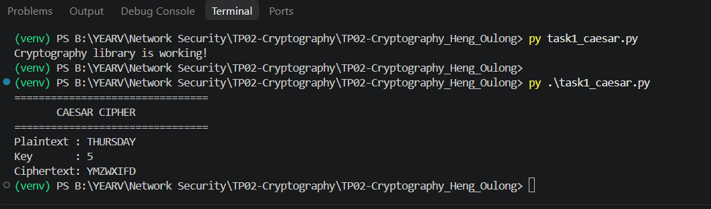
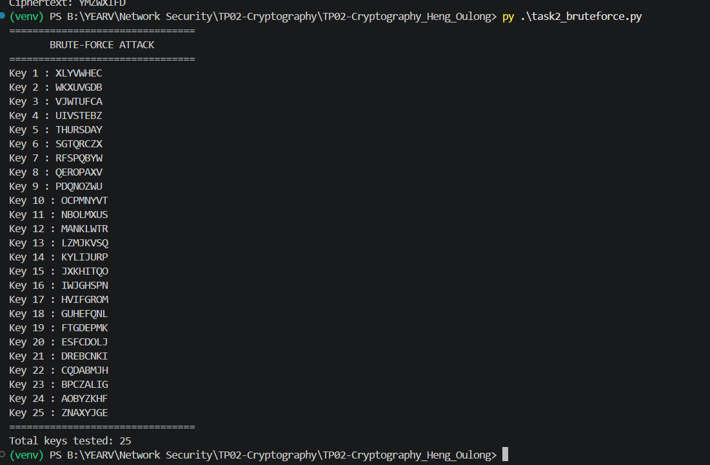
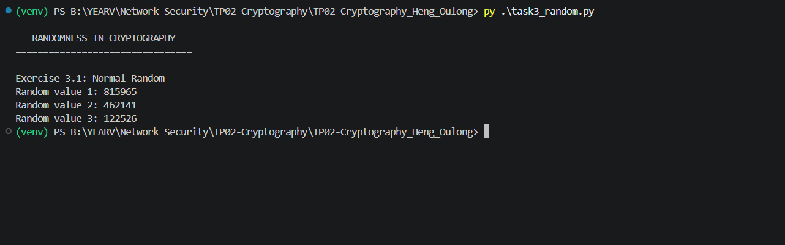
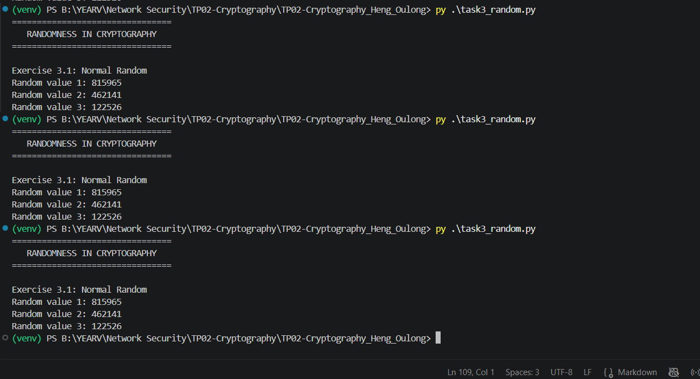
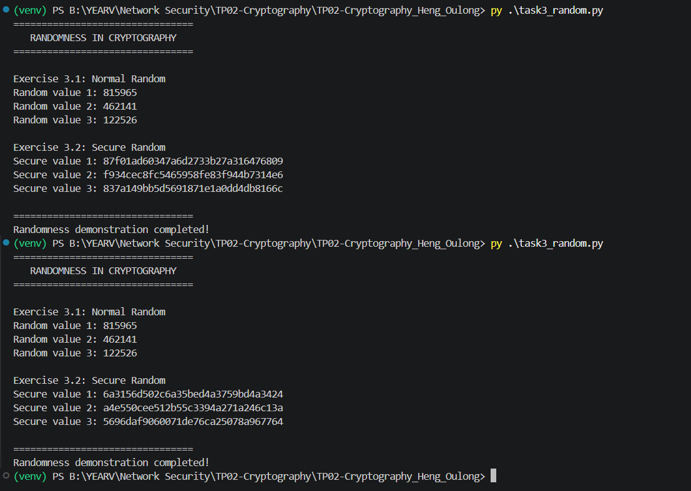
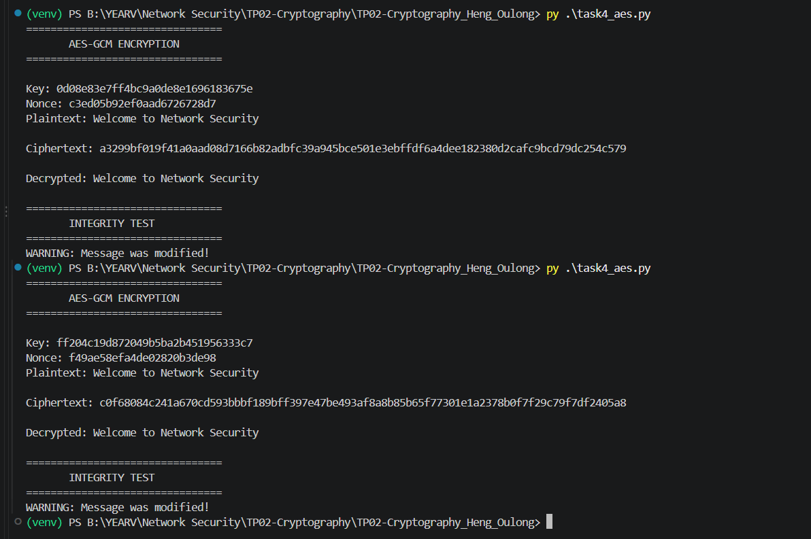
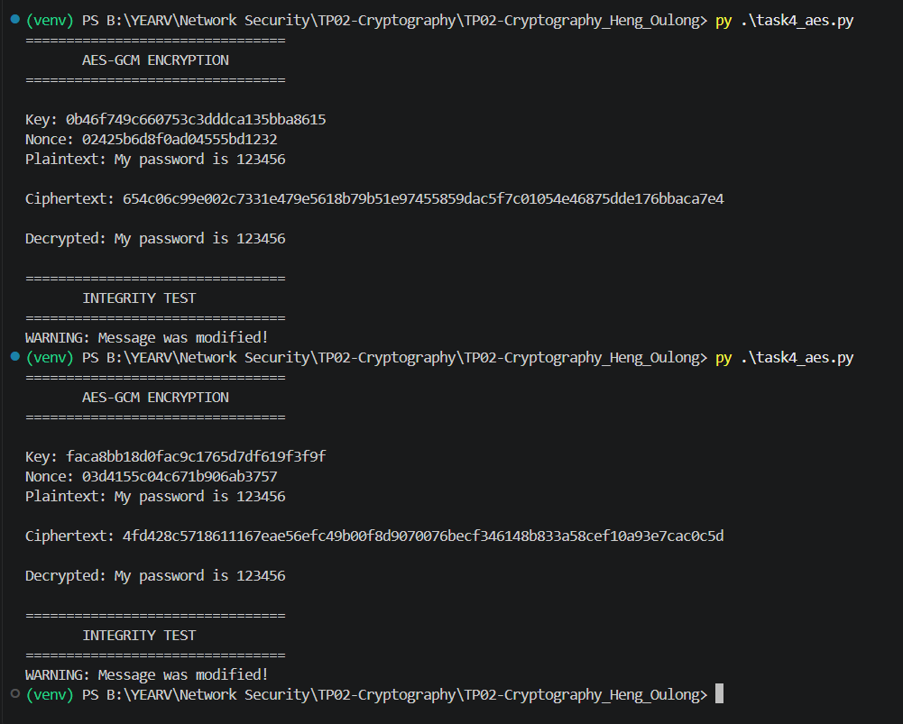
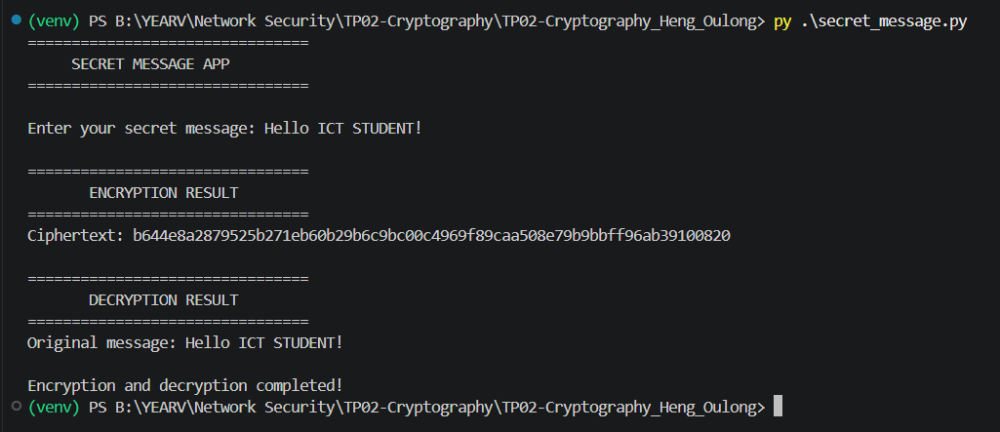

# TP03 – Cryptography Basics

**Course:** Network Security

**Topic:** Cryptography Basics

**Student Name:** Heng Oulong

**Student ID:** E20221390

## Task 1 – Caesar Cipher

### Exercise 1.1 – Manual Encryption

**Given:** Key = 5, Message: `THURSDAY`

### 1.1 Understand the problem

A Caesar Cipher encrypts a message by shifting every letter forward by a fixed number of positions.

For example:

- A → F
- B → G
- C → H
- T → Y

When we reach Z, we return to A.

The mathematical formula is:

$$E(x) = (x + k) \bmod 26$$

Where:

- $x$ = numerical position of the original letter.
- $k$ = encryption key.
- 26 = number of English alphabet letters.

**Manual solution:**

| Original | Encrypted |
| --- | --- |
| T | Y |
| H | M |
| U | Z |
| R | W |
| S | X |
| D | I |
| A | F |
| Y | D |

**Correct ciphertext:** `YMZWXIFD`

This is the result used in this report.

### Exercise 1.2 – Python Caesar Cipher

---

## Task 2 – Breaking Caesar Cipher

**Objective:** understand key space, brute-force attack, and why small keys are insecure.

- The Caesar cipher has only a very small number of possible keys.
- Instead of knowing the key, an attacker can simply try all possible values.

### Exercise 2.1 – Brute force

### Exercise 2.2 – Answers

1. **What is the correct key?**

   5

2. **How many possible keys were tested?**

   25

3. **Why is the Caesar cipher insecure?**

   Its key space is too small.

4. **If an attacker can simply try every key, what type of attack is this?**

   Brute-force attack

---

## Task 3 – Randomness in Cryptography

**Objective:** understand the difference between normal random numbers and cryptographically secure random numbers.

### Exercise 3.1 – Predictable randomness

**First run:**

**Second run (run the program again):**

**Questions**

1. **Do you receive the same numbers?** Yes / No
   
=> Yes, when the same seed and generator are used.

2. **Why?**

=> 	The same seed produces the same pseudo-random sequence.

### Exercise 3.2 – Secure randomness

**Questions**

1. **Why should we not use predictable numbers for encryption keys?**

   => Attackers could predict or reproduce them.

2. **Which Python module is more appropriate for security: random or secrets?**

   => secrets

---

## Task 4 – AES-GCM Encryption

We move from a historical cipher to modern cryptography using **AES-GCM**:

- **AES** is the encryption algorithm.
- **GCM** provides encryption + integrity / authentication.

### Exercise 4.1 – Different nonces

Run the program two times and compare key, nonce and ciphertext.

| Run | Key | Nonce | Ciphertext |
| --- | --- | --- | --- |
| Run 1 | Random | Random | Random |
| Run 2 | Random | Random | Random |

1. **Are the ciphertext values identical?** Yes / No

=> No.

2. **Why?**

=> The generated key and nonce are different, so the encrypted output is different.

### Exercise 4.2 – Modify the message

Change the message to `b"My password is 123456"` and run again.

## Task 5 – Mini Challenge

Program file: `secret_message.py`

**The program must:**

1. Generate an AES-128 key.
2. Generate a fresh nonce.
3. Ask the user to enter a message.
4. Encrypt the message.
5. Print the ciphertext.
6. Decrypt the ciphertext.
7. Print the original message again.

---

## Discussion Questions

Answer briefly.

1. **What is plaintext?**

   Plaintext is the original readable information before encryption. For example, HELLO is plaintext.

2. **What is ciphertext?**

   Ciphertext is the encrypted information produced after applying an encryption algorithm and a key. For example, KHOOR is the ciphertext of HELLO using Caesar key 3.

3. **What is the difference between encryption and decryption?**

   Encryption converts readable plaintext into ciphertext to protect information. Decryption converts ciphertext back into the original plaintext using the appropriate key.

4. **Why can the Caesar cipher easily be broken?**

   Because it has only 25 meaningful encryption keys. An attacker can test all possible keys using a brute-force attack.

5. **Why is AES stronger than DES?**

   AES supports key sizes of 128, 192 and 256 bits, while DES uses a 56-bit effective key. AES has a much larger key space and is considered secure for modern applications when correctly implemented.

6. **Why is randomness important in cryptography?**

   Randomness helps generate unpredictable cryptographic keys, nonces and security tokens. Predictable values can allow attackers to guess or reproduce sensitive information.

7. **What is a nonce?**

   A nonce is a value used during an encryption operation. In AES-GCM, a nonce must not be reused with the same key because reuse can seriously compromise security.

8. **Should a cryptographic key be predictable? Why?**

   No. A cryptographic key should be unpredictable. If an attacker can guess or reproduce the key, they may decrypt protected information.

